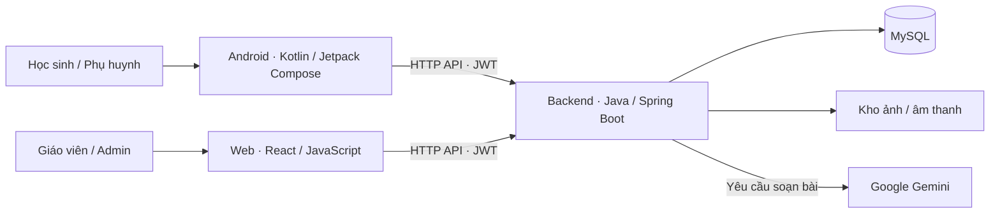

# Vui Học — Học chữ và tập viết tiếng Việt lớp 1

Vui Học giúp học sinh khám phá 29 chữ cái tiếng Việt, luyện viết trên bảng ô li
và làm bài cô giao. Phụ huynh theo dõi hoạt động của con trên Android; giáo viên
và quản trị viên sử dụng website React. Các ứng dụng dùng chung backend Java
và cơ sở dữ liệu MySQL.

Dự án phục vụ học tập và trình diễn. Đăng ký hiện kích hoạt tài khoản ngay,
không dùng OTP; địa chỉ email chưa được xác minh.

## Vai trò và chức năng

| Vai trò | Nền tảng | Chức năng chính |
| --- | --- | --- |
| Học sinh | Android | Hành trình 29 chữ; nghe mẫu; luyện viết; tham gia lớp; làm và nộp bài; xem điểm, nhận xét |
| Phụ huynh | Android | Liên kết con bằng mã; xem hoạt động theo ngày, tiến độ, bài nộp và nhận xét của cô |
| Giáo viên | Web | Quản lý lớp/học sinh; giao ba loại bài; xem bài làm, chấm điểm; chỉnh học liệu theo quyền; dùng trợ lý soạn bài |
| Quản trị viên | Web | Tổng quan hệ thống; quản lý tài khoản/quyền; quản lý học liệu; tra cứu lớp và liên kết gia đình; xem trạng thái cấu hình |

### Học sinh và phụ huynh

- Hành trình học lần lượt: **đọc → viết 2 lượt → điền 3 từ → ghép 3 câu**.
  Hoàn thành một chữ để mở chữ tiếp theo; có thể ôn lại chữ đã học.
- Đọc chữ có chữ hoa/thường, từ ví dụ và âm thanh học liệu; dùng TTS tiếng Việt
  dự phòng khi cần. Bé nghe và tự đọc theo, không thu âm hoặc nhận dạng phát âm.
- Bảng tập viết có mẫu chữ, giấy ô li, điều chỉnh độ đậm, hoàn tác và xóa có xác nhận.
  Chấm viết đo độ bám mẫu, độ phủ và độ chính xác của nét.
- Lớp học chia thành ba nhóm màu: **Tập viết chữ**, **Đố vui ghép chữ**, **Ghép câu**;
  huy hiệu thể hiện bài chưa nộp theo lớp và theo loại.
- Phiên đăng nhập được mã hóa trên Android. Tiến độ, bản nháp và hàng đợi hoạt động
  được tách theo máy chủ/tài khoản; hoạt động chờ được gửi lại khi có kết nối.
- Phụ huynh dùng mã liên kết một lần do học sinh cung cấp để xem hoạt động theo
  ngày, tiến độ 29 chữ, thống kê bảy ngày và bài đã nộp.

### Giáo viên và trợ lý AI

Giáo viên soạn đủ ba loại bài bằng biểu mẫu, kho mẫu cục bộ hoặc trợ lý **Google
Gemini**. Trợ lý tạo bản nháp có cấu trúc; cô xem, chỉnh nội dung, chọn lớp rồi mới
bấm giao bài. Bài viết được backend chấm từ ảnh; cô có thể sửa điểm/nhận xét,
đồng thời hệ thống giữ điểm tự động ban đầu.

Trợ lý soạn bài dùng HTTP. Dự án không cung cấp chat realtime giữa các vai trò
hoặc kết nối WebSocket.

## Kiến trúc



| Thành phần | Công nghệ trong dự án | Hướng dẫn |
| --- | --- | --- |
| Android | Kotlin, Jetpack Compose, Material 3; Android 8.0/API 26 trở lên | [android/README.md](android/README.md) |
| Backend | Java 17, Spring Boot 3.3.2, Spring Security/JWT, JPA, Flyway, MySQL | [backend/README.md](backend/README.md) |
| Website | React 19, JavaScript/JSX, Vite 8, Axios, CSS, Lucide | [frontend/README.md](frontend/README.md) |

```text
.
├── android/       Ứng dụng học sinh/phụ huynh và quy tắc phát triển
├── backend/       API, phân quyền, chấm bài, báo cáo và kết nối Gemini
├── frontend/      Website giáo viên/admin và tài sản giao diện
└── README.md      Tổng quan và hướng dẫn chạy nhanh
```

## Chạy dự án local

### 1. Chuẩn bị

- Backend: JDK 17 trở lên, Maven và MySQL 8.
- Website: Node.js 22.12 trở lên và npm.
- Android: Android Studio, **Gradle JDK 21**, Android SDK Platform 36.1,
  Build-Tools 36.0.0 và Platform-Tools.

Có thể dùng JDK 21 cho cả backend và Android. Các lệnh dưới đây dùng PowerShell
và chạy từ thư mục gốc repository, trừ khi ghi khác.

### 2. Backend và cơ sở dữ liệu

Tạo database `viet_letters_db` theo [hướng dẫn backend](backend/README.md), sau đó:

```powershell
cd backend
if (!(Test-Path .env.local)) { Copy-Item .env.example .env.local }
```

Mở `backend/.env.local`, điền `DB_USERNAME`, `DB_PASSWORD` và `APP_JWT_SECRET`.
JWT secret cần ngẫu nhiên, ít nhất 64 byte UTF-8. File này chỉ ở máy của bạn.

Từ thư mục `backend`, chạy:

```powershell
mvn spring-boot:run
```

API mặc định: `http://localhost:8080`. Flyway áp dụng migration khi khởi động;
không cần import thủ công từng file SQL. Với dữ liệu đã có, sao lưu trước khi
áp dụng migration mới và không sửa các migration đã chạy.

### 3. Website giáo viên/admin

Mở terminal khác từ thư mục gốc:

```powershell
cd frontend
npm ci
npm run dev
```

Truy cập **http://localhost:5173**. Vite chuyển tiếp `/api` tới backend local;
trình duyệt không kết nối MySQL trực tiếp.

### 4. Android học sinh/phụ huynh

Mở riêng thư mục `android` bằng Android Studio, chọn **Gradle JDK 21**, Sync rồi
Run cấu hình `app` trên thiết bị thật hoặc máy ảo đã có.

Trong bản debug, vào **Cài đặt kết nối** ở màn hình đăng nhập:

| Trường hợp | Địa chỉ backend |
| --- | --- |
| Android Emulator trên cùng máy tính | `http://10.0.2.2:8080/` |
| Điện thoại cùng mạng với máy tính | `http://<IP-LAN-của-máy-tính>:8080/` |
| Thiết bị có ADB reverse cổng 8080 | `http://127.0.0.1:8080/` |

Lấy IP máy tính bằng `ipconfig`. Khi IP thay đổi, cập nhật lại kết nối trong app.
`localhost` trên điện thoại là chính điện thoại. Xem [cách build và xử lý kết nối](android/README.md).

## Tài khoản và luồng trình diễn

- Android đăng ký **học sinh/phụ huynh**. Website đăng ký thêm **giáo viên**.
  Đăng ký xong có thể đăng nhập ngay; không có đăng ký admin công khai.
- Dữ liệu khởi tạo có các tên `admin`, `teacher1`, `student1`, `parent1`.
  Mật khẩu/quyền trong database đang dùng có thể đã thay đổi. Backend không tự
  đặt lại mật khẩu hoặc bật lại tài khoản khi khởi động. Xem [thiết lập admin](backend/README.md#tài-khoản-và-quản-trị-ban-đầu).
- Quên mật khẩu do admin hỗ trợ đặt lại. Tài khoản bị khóa cần admin xử lý.

Luồng trình diễn gợi ý:

1. Giáo viên tạo lớp, lấy mã mời và giao ba loại bài.
2. Học sinh tham gia bằng mã, làm/nộp bài và xem kết quả.
3. Giáo viên mở bài viết, lưu điểm và nhận xét.
4. Học sinh lấy mã tại **Hồ sơ → Liên kết phụ huynh**.
5. Phụ huynh nhập mã ở **Gia đình**, chọn con để xem **Hôm nay** và **Tiến độ**.
6. Admin kiểm tra tài khoản, học liệu và tra cứu lớp/liên kết gia đình trên web.

## Cấu hình Gemini

Điền `GEMINI_API_KEY` vào `backend/.env.local` rồi khởi động lại backend.
Model và địa chỉ dịch vụ được cấu hình ở backend; khóa không nằm trong APK hoặc
biến `VITE_*`. Không gửi thông tin riêng của học sinh trong lời nhắc soạn bài.
Xem [cấu hình Gemini và kiểm thử thật](backend/README.md#trợ-lý-soạn-bài-gemini).

## Kiểm thử

- Backend: từ `backend`, chạy `mvn test`.
- Website: từ `frontend`, chạy `npm test`, `npm run lint`, `npm run build`.
- Android: từ `android`, chạy
  `.\gradlew.bat :app:testDebugUnitTest :app:assembleDebug :app:lintDebug`.

Kiểm thử MySQL/Android/AI thật chỉ bật có chủ đích bằng các cờ riêng. Không dùng
kiểm thử tự động để sửa dữ liệu của tài khoản đang sử dụng. Các lệnh và phạm vi
được ghi tại [backend](backend/README.md#kiểm-thử), [website](frontend/README.md#kiểm-thử)
và [quy định Android](android/docs/TESTING.md).

## Phạm vi và giới hạn hiện tại

- Đăng ký không OTP phục vụ demo; email chưa xác minh. Chưa có luồng tự khôi phục
  mật khẩu qua email/SMS.
- Chấm viết là đánh giá hình học độ bám mẫu HP001, chưa xét thứ tự nét hay thay
  thế đánh giá sư phạm. Học liệu do dự án biên soạn cần được giáo viên duyệt.
- Có cache và hàng đợi đồng bộ; đăng nhập, tham gia lớp, nộp bài và tải báo cáo
  vẫn cần backend. Nét tự luyện và bản nháp cục bộ không tự chuyển sang máy mới.
- TTS cần bộ đọc và giọng tiếng Việt trên thiết bị. Kiểm thử API không thay thế
  kiểm tra thao tác chạm, bàn phím, âm thanh và xoay màn hình thực tế.
- Triển khai ngoài local cần cấu hình HTTPS, CORS theo môi trường, ký APK và
  sao lưu database cùng kho media. Cấu hình hiện có tập trung cho phát triển/demo.

## Tài liệu phát triển

Bắt đầu Android tại [android/AGENTS.md](android/AGENTS.md). Các tài liệu trong
[android/docs](android/docs/) quy định kiến trúc, xác thực, hành trình, lớp học,
phụ huynh, tập viết và kiểm thử. Font Nunito Sans có giấy phép đi kèm tại
[Android](android/licenses/NunitoSans-OFL.txt) và [website](frontend/public/fonts/NunitoSans-OFL.txt).
